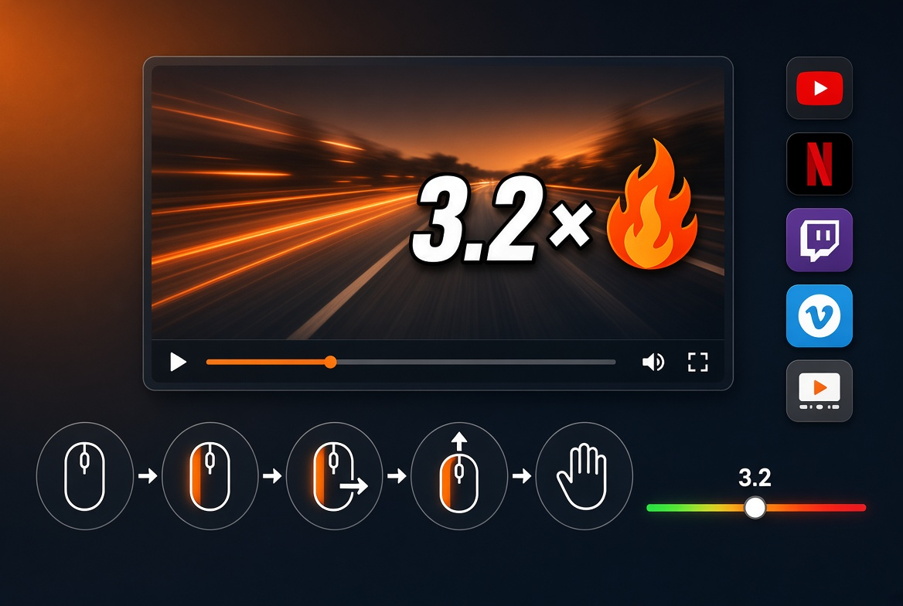

<div align="center">

# 🔥 Video Speed Up

**Ускорение видео на любом сайте — перетаскиванием мыши.**



Зажмите левую кнопку мыши на видео и тяните вправо — скорость вырастет с 1× до 4×.
Потяните вверх — скорость зафиксируется и останется до конца ролика.

[](LICENSE)
[](manifest.json)
[](https://www.google.com/chrome/)

</div>

---

## Управление

| Действие | Результат |
|---|---|
| **Зажать** ЛКМ на видео (200 мс) | Включается режим управления, появляется индикатор |
| **Тянуть вправо / влево** | Скорость от **1.0× до 4.0×** (шаг 0.2×) |
| **Тянуть вверх** | 🔒 **Зафиксировать** скорость — останется после отпускания |
| **Тянуть вниз** | Сбросить скорость на 1.0× |
| **Отпустить** без фиксации | Скорость вернётся к 1.0× |

Индикатор — оранжевый огонёк и белая цифра с чёрной обводкой в правом верхнем углу видео.
Огонёк загорается жёлтым, когда скорость зафиксирована.

## Где работает

- YouTube (включая встроенные плееры)
- Kodik / player.cdnvideohub.com (в том числе плеер внутри shadow DOM)
- JW Player, HTML5 `<video>`, HLS/MSE-плееры
- Стримы: Twitch, VK, YouTube Live и другие
- Плееры в iframe и на сайтах-кинотеатрах

Кнопки самого плеера (пауза, звук, перемотка, качество, полный экран) продолжают работать —
расширение их не перехватывает. Текст на странице тоже можно выделять и копировать как обычно.

---

## Установка в Chrome / Edge / Brave / Opera

Расширение не публикуется в магазинах — ставится вручную из исходников.

### Вариант 1. Из архива (самый простой)

1. Скачайте [архив релизов](https://github.com/N0H3/video-speed-up/releases) или клонируйте репозиторий
2. **Распакуйте** архив в отдельную папку (внутри должен лежать `manifest.json`)
3. Откройте `chrome://extensions`
4. Включите **Режим разработчика** (тумблер в правом верхнем углу)
5. Нажмите **«Загрузить распакованное расширение»** и выберите папку с `manifest.json`
6. Готово — иконка 🔥 появится в панели расширений

> Значок «Скачать» на странице релизов отдаёт `.zip` — Chrome не ставит zip напрямую,
> его нужно сначала распаковать (правой кнопкой → «Извлечь сюда»).

### Вариант 2. Из исходников

```bash
git clone https://github.com/N0H3/video-speed-up.git
cd video-speed-up
```

Далее — как в варианте 1, шаги 3–6 (уже распакованная папка).

### Включение / выключение

Кликните по иконке расширения → кнопка **ВКЛЮЧИТЬ / ОТКЛЮЧИТЬ**.
Состояние сохраняется и синхронизируется между вкладками.

---

## Сборка архива из исходников

```bash
cd video-speed-up
zip -r video-speed-up.zip manifest.json content.js popup.html popup.js images
```

Готовый архив уже лежит в [Releases](https://github.com/N0H3/video-speed-up/releases).

---

## Разработка

```
video-speed-up/
├── manifest.json          # Manifest V3
├── content.js             # основная логика (поиск видео, жесты, HUD)
├── popup.html / popup.js  # окошко вкл/выкл
├── images/                # иконки + иллюстрация для README
└── docs/privacy.html      # страница политики конфиденциальности
```

Ключевые моменты реализации:

- **Поиск видео** — в обычном DOM, в shadow DOM (open) и внутри iframe (`all_frames`)
- **Отсев рекламы** — видео внутри `ads` / `vast` / `vpaid` / `creative` контейнеров имеют низкий приоритет
- **`e.composedPath()`** — в shadow DOM `e.target` указывает на хост, а не на реальный элемент
- **Защита от «залипания»** — сброс активного режима по `pointerup`, `blur`, `visibilitychange` и watchdog-таймеру
- **Никакого `preventDefault()` на клике** — чтобы не ломать выделение текста на странице
- **Все обработчики в `try/catch`** — ошибка расширения никогда не попадает в консоль страницы

## Конфиденциальность

Расширение **не собирает и никуда не отправляет** никакие данные.
Всё работает локально в браузере, настройки хранятся в `chrome.storage.sync`.
Подробнее — в [PRIVACY.md](PRIVACY.md) и [docs/privacy.html](docs/privacy.html).

## Лицензия

MIT — см. [LICENSE](LICENSE).
